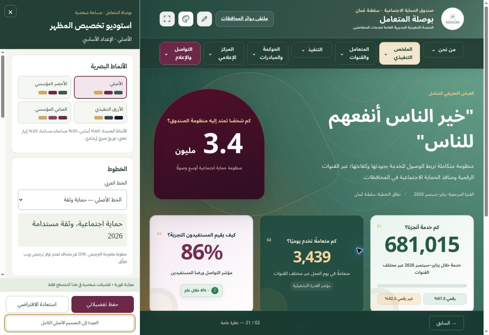
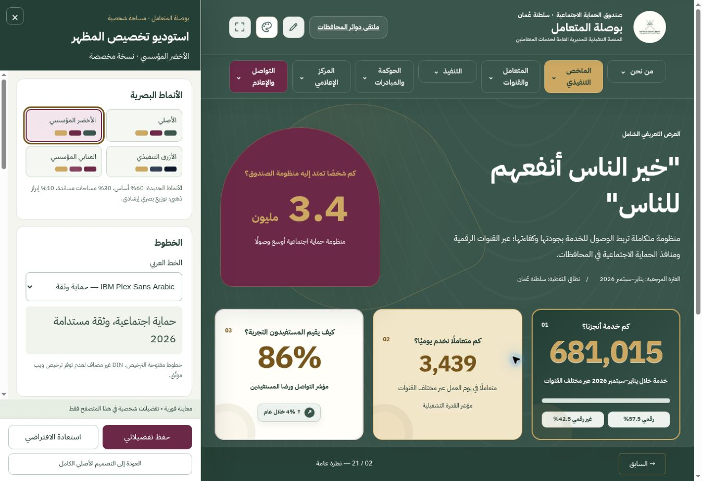
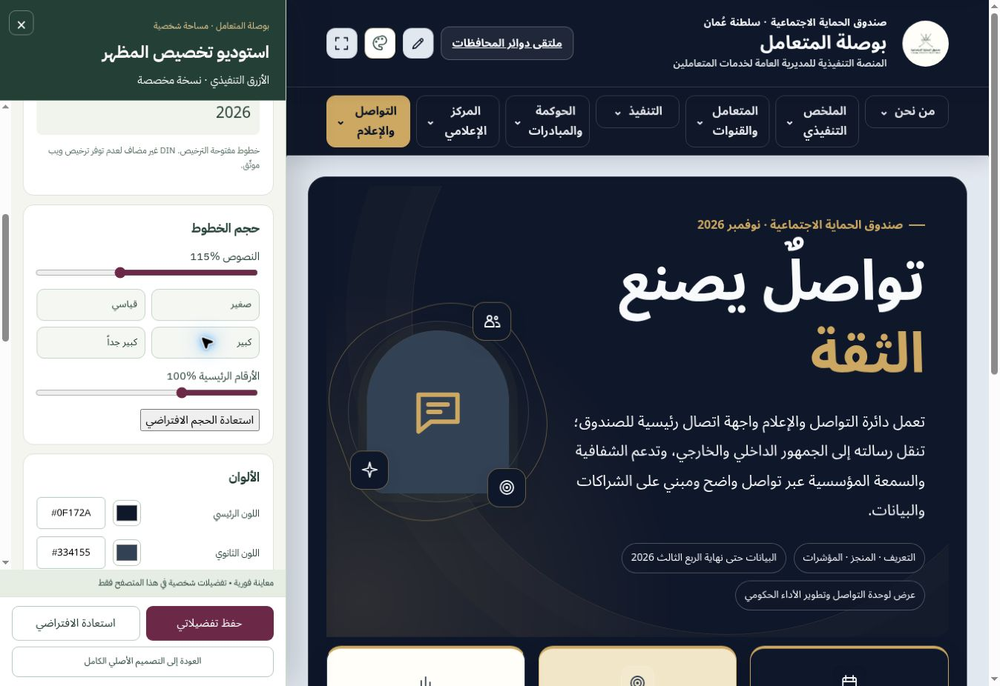
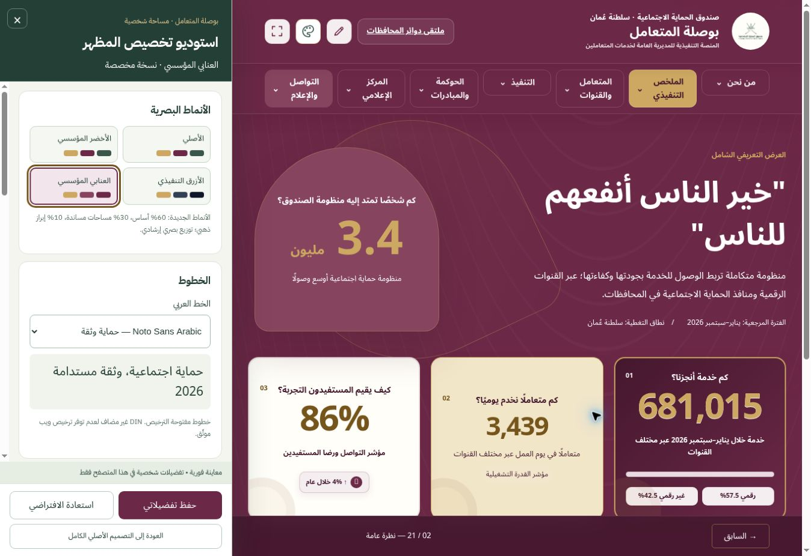
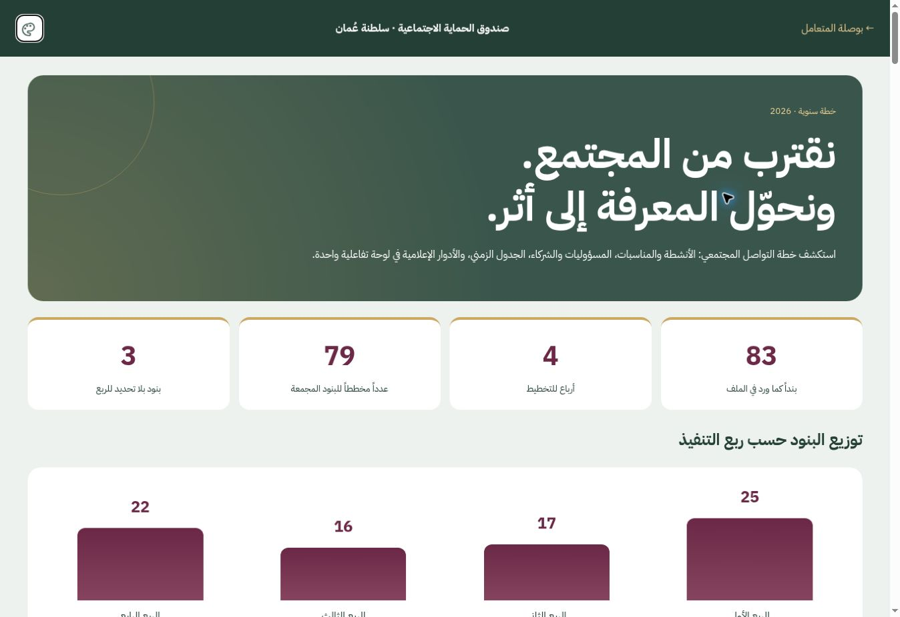
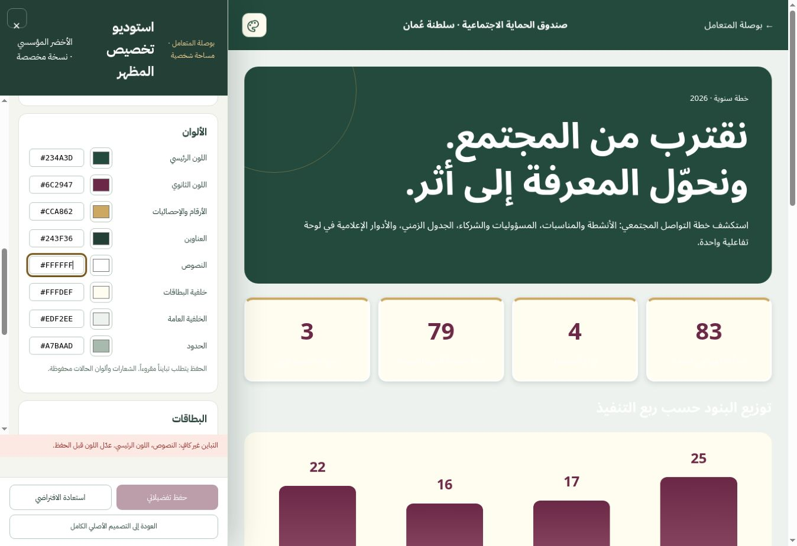
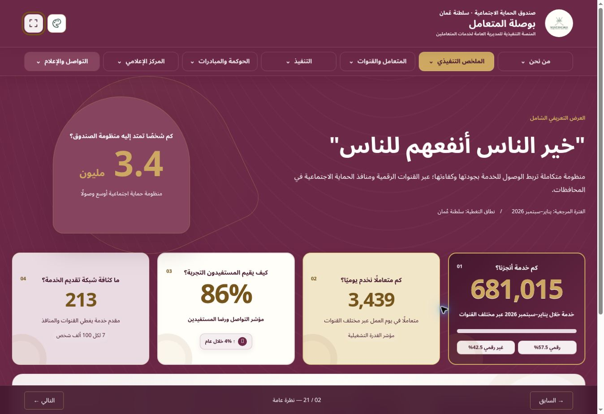
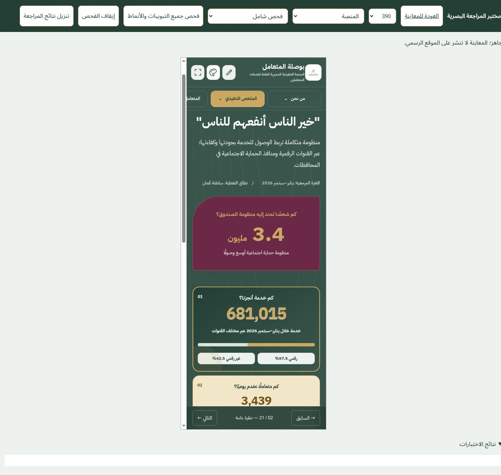

# تقرير المراجعة التجريبية — استوديو تخصيص المظهر وخطة التواصل المجتمعي

التاريخ: 11 نوفمبر 2026. الحالة: نسخة تجريبية مستقلة للمراجعة، وليست اعتماداً للنشر الرسمي.

## الخصائص المنفذة

- لوحة جانبية عربية RTL من أيقونة بجوار أداة التحرير، مع معاينة فورية بلا إعادة تحميل أو تغيير بيانات التبويب.
- الأنماط الأربعة: الأصلي، الأخضر المؤسسي، الأزرق التنفيذي، العنابي المؤسسي. تخصيصات منفصلة لكل نمط وإشارة «نسخة مخصصة».
- الخط الأصلي وIBM Plex Sans Arabic وNoto Sans Arabic، محملة محلياً بتراخيص OFL.
- النصوص 90–130% والأرقام 85–130%، أربعة أحجام جاهزة واستعادة مستقلة للأحجام. ملاءمة الأرقام الطويلة لمساحة البطاقة.
- ثمانية ألوان مع منتقي وHEX، وفحص تباين يمنع الحفظ عند ضعف الوضوح أو قيمة HEX غير صحيحة؛ حماية ألوان الشعارات ودلالات الحالة.
- ثلاث مجموعات للبطاقات، وضبط الاستدارة والظل والحدود والحشو.
- أربعة مستويات للحركة، مع احترام تفضيل الجهاز لتقليل الحركة.
- حفظ شخصي بإصدار في localStorage بمفتاح busola.appearance.v1، واستعادة أساس النمط أو الأصل الكامل.
- لوحة خطة التواصل المجتمعي: جميع الصفوف الـ83 والحقول الـ13، بحث وتصفية وبطاقات وجدول وتفاصيل وطباعة. ربطها في موضعي الحوكمة والتواصل والإعلام.

## سلامة محتوى الخطة

طابق التحقق البرمجي كل خلية من 83 صفاً × 13 حقلاً مع الإكسل. لا حذف للتكرارات أو تصحيح افتراضي للمصدر. التوزيع حسب علامات الأرباع هو 25 / 17 / 16 / 22، مع 3 صفوف بلا ربع. الرقم 79 هو مجموع خانة العدد لأربعة بنود مجمعة، وليس مجموع جميع أنشطة الخطة؛ وُضع له وصف صريح. الإكسل الأصلي متاح داخل اللوحة للاطلاع المرجعي.

## نتائج فحص الواجهة

أُجريت 1344 قراءة هندسية: 28 صفحة/حالة × 4 أنماط × 3 إعدادات طباعية × 4 عروض (390، 768، 1440، 1920 بكسل). ظهرت 22 قراءة مبكرة لقصّ أرقام قبل استقرار الرسم. أُعيد فحص مواضع الهاتف واللوحي بعد انتظار إطارَي الرسم وملاءمة الأرقام، ونجحت 176 حالة دون تجاوز أفقي للصفحة أو قصّ مرصود في العناصر المقاسة.

هذه قراءات هندسية آلية وليست 1344 مراجعة بصرية يدوية. المراجعة البصرية الفعلية استخدمت لقطات المتصفح للأنماط الأربعة والخطوط ولوحة الخطة والتباين والشاشة الكاملة والهاتف. الفحص لا يثبت عدم وجود كل عيب محتمل في محتوى مخفي أو محمي.

## التحقق الوظيفي

| الاختبار | النتيجة |
| --- | --- |
| اختيار الأنماط والخطوط والحجوم | يعمل مباشرة دون مغادرة التبويب |
| حفظ المظهر وإعادة التحميل | احتُفظ بالنمط والخط المحفوظين |
| لون رئيسي صالح #234A3D | قُبل وبقي الحفظ متاحاً |
| نص أبيض فوق خلفية فاتحة | عُطّل الحفظ وظهر تنبيه التباين |
| استعادة الأصل بعد تخصيص الألوان | تطابقت الألوان والأحجام المقاسة مع الأصل |
| الاحتفاظ ببحث «ورشة» أثناء تغيير المظهر | بقيت النتائج 9 من 83 |
| تصفية الصفوف بلا ربع | 3 نتائج، ثم 83 بعد مسح التصفية |
| رابطا الخطة | كلاهما يفتح HTML مع عنوان «استعراض الخطة التفاعلية» |
| الشاشة الكاملة | الشريط العلوي والتنقل العلوي والسفلي منفصلة، وأيقونة المظهر ظاهرة |
| أداة تعديل المحتوى | نافذة الدخول الحالية ما زالت تفتح؛ لم ينفذ حفظ تشغيلي |
| البيانات والأرقام وآلية الحماية | ملفات app.js وdata.js وdashboard-edits وملفات التشفير لم تتغير |

## أوامر التحقق

- python appearance-studio/verify.py — نجح: مطابقة المصدر وثبات الملفات وسلامة JavaScript.
- node appearance-studio/test-contrast.cjs — نجح: تباين الألوان والشفافية وأسوأ خلفية متدرجة.
- node scripts/test_catalog_overrides.mjs — نجحت مجموعتا اختبارات الكتالوج الحالية.
- فحص الصياغة لملفات الحركة والتواصل والأنماط، وgit diff --check — نجح.

## حدود التحقق المتبقية

- لم تُفتح الأجزاء الداخلية للتبويبات الثلاثة المحمية: الخطة التشغيلية، متابعة الأعمال، اللجان والفرق. اختُبرت واجهات قفلها فقط. يلزم اختبار داخلي بحساب مخول قبل اعتماد الموقع الرسمي.
- المعاينة تمنع الكتابة الخارجية، لذلك لم يُختبر الحفظ التشغيلي أو رفع بيانات GitHub من أدوات التحرير. هذا القيد خاص بالمعاينة ولا يضاف إلى تكامل النشر الرسمي.
- اختُبر Chromium مع مقاسات عرض محاكية. لم يُختبر Safari أو Firefox أو أجهزة iOS/Android فعلية.
- الخطوط المرسومة داخل الصور وملفات PDF لا تتغير؛ التخصيص يشمل عناصر HTML.
- DIN غير مضاف لعدم وجود ترخيص ويب موثق. لم يُنشأ ملف Figma مستقل؛ المخرج المنفذ هو الواجهة التفاعلية في فرع GitHub.
- توزيع 60–30–10 توجيه بصري للأنماط، وليس قياساً حسابياً لمساحة كل صفحة أو بطاقة. الألوان الفردية المخصصة تخضع لفحص التباين عند الحفظ.

## ملخص الملفات

| المجموعة | التغيير |
| --- | --- |
| appearance-studio/appearance-studio.js و.css | الاستوديو والتفضيلات والتطبيق والتخطيط المتجاوب |
| appearance-studio/themes.js و.css وcontrast.js | الرموز الدلالية والأنماط والتباين ودعم Shadow DOM |
| appearance-studio/build-plan.py وintegrate.py | توليد الخطة ودمج الأصول في الصفحات |
| overrides/reports/community-communication-plan-2026.html | لوحة الخطة بجميع محتويات المصدر |
| overrides/assets/fonts/ | Noto المحلي وترخيص OFL |
| communications/integrated.js وpatches/patch_index.py | رابطا الخطة ومفاتيح تحرير جديدة لعناوين الرابط |
| overrides/assets/motion-system.js | الاستجابة لتفضيلات الحركة دون تغيير البيانات |
| .github/workflows/deploy-pages.yml | استدعاء الدمج عند بناء الموقع بعد اعتماد دمج الفرع مستقبلاً |
| appearance-studio/verify.py وtest-contrast.cjs وreview.html | التحقق الآلي ومختبر المقاسات |
| appearance-studio/isolation.js | عزل الكتابة في النسخة التجريبية فقط |
| appearance-studio/qa/ | التقرير ونتائج القياس ولقطات المتصفح |

## تغطية التبويبات

الجدول التالي يسجل نطاق القياس الهندسي لكل صفحة. اللقطات المرئية تمثل الحالات الرئيسية، ولا تعني فحصاً يدوياً لكل تركيب ممكن.

| الصفحة | نطاق التحقق |
| --- | --- |
| about | الأنماط الأربعة × ثلاثة إعدادات × أربعة عروض |
| overview | الأنماط الأربعة × ثلاثة إعدادات × أربعة عروض |
| performance | الأنماط الأربعة × ثلاثة إعدادات × أربعة عروض |
| achievements | الأنماط الأربعة × ثلاثة إعدادات × أربعة عروض |
| methodology | الأنماط الأربعة × ثلاثة إعدادات × أربعة عروض |
| coverage | الأنماط الأربعة × ثلاثة إعدادات × أربعة عروض |
| channels | الأنماط الأربعة × ثلاثة إعدادات × أربعة عروض |
| contact-center | الأنماط الأربعة × ثلاثة إعدادات × أربعة عروض |
| practices | الأنماط الأربعة × ثلاثة إعدادات × أربعة عروض |
| tajawob | الأنماط الأربعة × ثلاثة إعدادات × أربعة عروض |
| operational-plan | واجهة القفل فقط |
| work-tracker | واجهة القفل فقط |
| risk-register | الأنماط الأربعة × ثلاثة إعدادات × أربعة عروض |
| directorate | الأنماط الأربعة × ثلاثة إعدادات × أربعة عروض |
| committees | واجهة القفل فقط |
| projects | الأنماط الأربعة × ثلاثة إعدادات × أربعة عروض |
| community-line | الأنماط الأربعة × ثلاثة إعدادات × أربعة عروض |
| media-center | الأنماط الأربعة × ثلاثة إعدادات × أربعة عروض |
| service-achievements | الأنماط الأربعة × ثلاثة إعدادات × أربعة عروض |
| recognitions | الأنماط الأربعة × ثلاثة إعدادات × أربعة عروض |
| communications | الأنماط الأربعة × ثلاثة إعدادات × أربعة عروض |
| communications/intro | الأنماط الأربعة × ثلاثة إعدادات × أربعة عروض |
| communications/strategy | الأنماط الأربعة × ثلاثة إعدادات × أربعة عروض |
| communications/channels | الأنماط الأربعة × ثلاثة إعدادات × أربعة عروض |
| communications/community | الأنماط الأربعة × ثلاثة إعدادات × أربعة عروض |
| communications/performance | الأنماط الأربعة × ثلاثة إعدادات × أربعة عروض |
| communications/coordination | الأنماط الأربعة × ثلاثة إعدادات × أربعة عروض |
| communications/savings | الأنماط الأربعة × ثلاثة إعدادات × أربعة عروض |

## لقطات المتصفح

### الأصل مع الاستوديو

### الأخضر — IBM Plex

### الأزرق — Noto وحجم 115%

### العنابي — Noto

### لوحة خطة التواصل المجتمعي

### منع حفظ ألوان ضعيفة التباين

### الشاشة الكاملة وأيقونة المظهر

### محاكاة الهاتف بعرض 390

