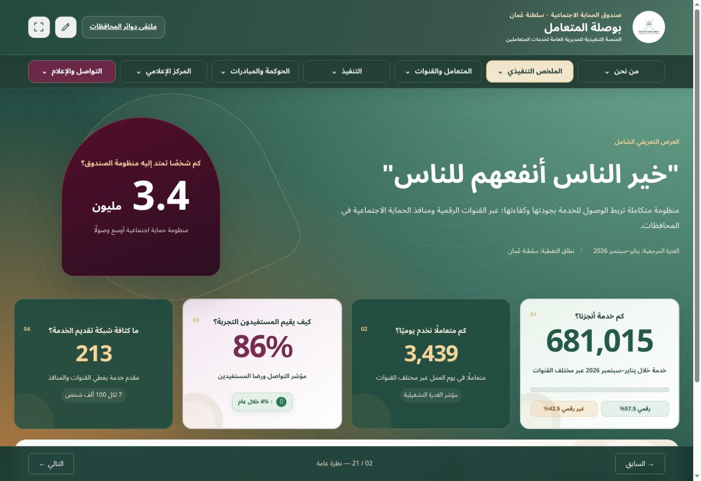
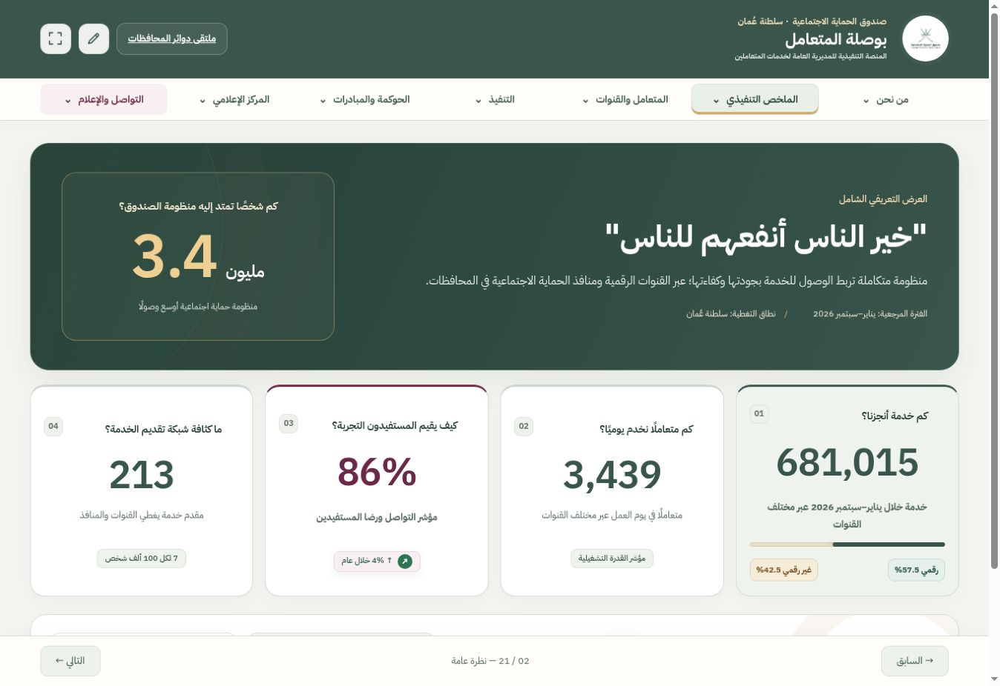
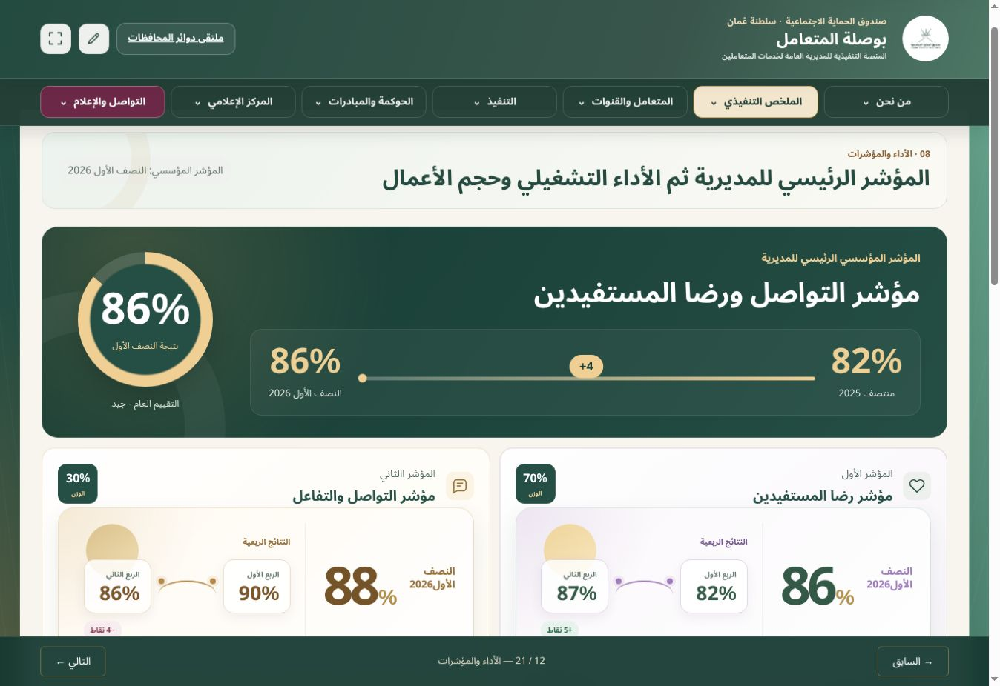
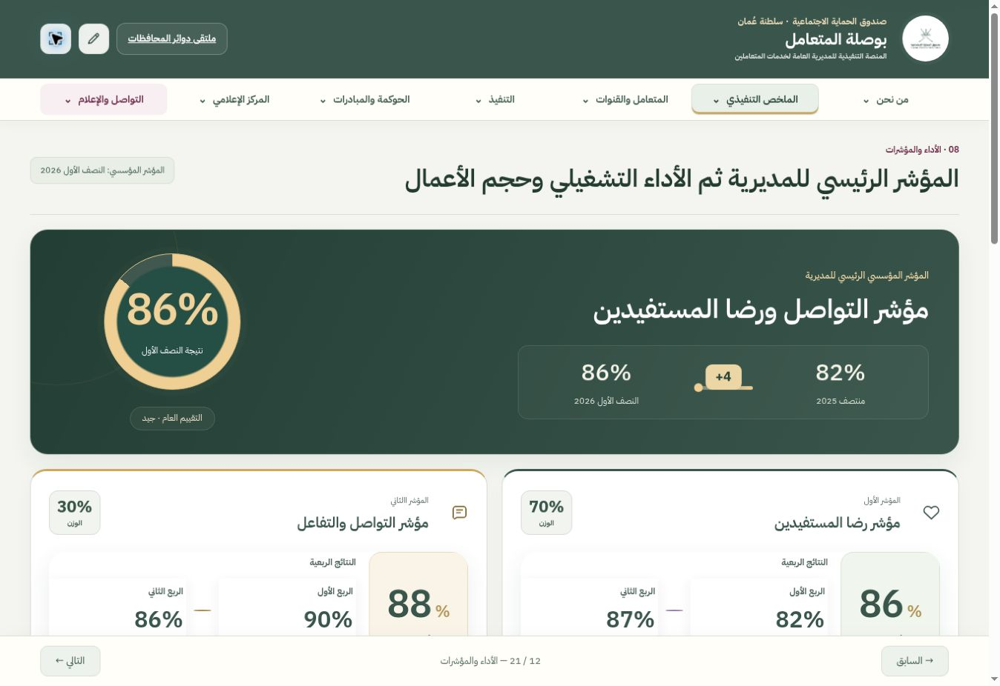

# مراجعة التطوير البصري — بوصلة المتعامل

10 نوفمبر 2026 · نموذج للمراجعة قبل الاعتماد

جرى إعداد النموذج على الإصدار المنشور من المستودع `CustomerServices2040/spf-customer-services`، عند الالتزام `fcd2fe2f350c33af119c7909cd0c0dc6d73cfba4`. بقي الفرع الرئيسي ومسار نشر GitHub Pages دون تعديل. الاسم الفعلي للتبويب في المشروع هو «نظرة عامة» وقد احتُفظ به.

التقييم البصري التقديري للنسخة الحالية: **6.5/10**. الهوية واضحة والمحتوى غني، لكن كثافة التنسيق وتفاوت أحجام العناصر والزخارف المتراكمة تقلل اتساق القراءة. النموذج يحسّن وضوح التبويبين؛ اعتماد وصف «State-of-the-Art» للمنصة كاملة يتطلب استكمال بقية الأقسام واختبار المستخدمين بعد الموافقة.

## الملاحظات بحسب الأولوية

| الأولوية | الملاحظة المحددة | المعالجة / المرحلة |
|---|---|---|
| عالية | مقدمة «نظرة عامة» تفصل المؤشرات عن بداية الشاشة بمساحة كبيرة | خفض ارتفاع المقدمة وإظهار صف المؤشرات أقرب إليها |
| عالية | أكثر من 3,600 قاعدة CSS على المستوى الأعلى موزعة على ثمانية ملفات، مع تصحيحات متتابعة | طبقة نموذج واحدة محددة النطاق؛ لا إزالة أو إعادة ترتيب للملفات الحالية |
| عالية | أحجام الخطوط والأرقام والأوزان تختلف بين البطاقات؛ بعض الأيقونات تتضاءل بسبب padding داخل SVG | سلم خط عربي موحد، أرقام متناسقة، تصحيح قياس أيقونات النموذج |
| عالية | زخارف دائرية في بطاقات المؤشرات تتداخل مع النتائج وتزيد الامتداد خارج البطاقات | إزالة الزخارف الفارغة المتعارضة في النموذج؛ إبقاء الرسوم الحاملة للبيانات |
| متوسطة | ازدحام عرض النتائج النصفية والربعية وأوزان 70% و30% | توحيد التسلسل داخل البطاقات مع إبقاء جميع النتائج والفترات |
| متوسطة | تفاوت خلفيات وعناوين وأرقام الأقسام الأخرى، خصوصاً التغطية والقنوات والممارسات والتقارير | مسجلة للمرحلة التالية؛ لم يطبّق عليها النظام الجديد |
| متوسطة | التصفح في الهاتف يحتاج المحافظة على وضوح القائمة والحالة النشطة | تحسين المظهر والحالة النشطة؛ إبقاء الترتيب وآلية القائمة الحالية |
| منخفضة | صورة شعار واحدة غير محملة أثناء فحص الشهادات والدروع؛ قد تتأثر الصور الخارجية بالشبكة | رُصدت ولم تُستبدل ضمن نموذج التبويبين |

## نطاق التنفيذ

تغييرات العرض موجودة في `preview/visual-pilot.css` و`preview/visual-pilot.js`. تتفعّل فقط عندما يكون التبويب الظاهر «نظرة عامة» أو «الأداء والمؤشرات»، وتعود الأقسام الأخرى لتنسيقها الحالي عند التنقل إليها. تحسين شريط التنقل والعنوان والتذييل البصري مرتبط بالتبويبين أيضاً.

- الأخضر `#3A564C` والذهبي `#CCA862` والعنابي `#6C2947` مع خلفيات مساندة أهدأ.
- خط IBM Plex Sans Arabic محلي بأوزان متاحة فعلياً، ودون خدمة خطوط خارجية جديدة.
- توحيد البطاقات والحدود والظلال والمسافات وإبراز الأرقام الرئيسية.
- إبقاء 3.4 مليون و681,015 و3,439 و86% و213 وجميع الأرقام الأخرى والفترات كما هي بعد تحميل التعديلات المحفوظة.
- تحسين عرض المؤشر الرئيسي ومكوناته والأداء التشغيلي وحجم الأعمال والمكالمات.
- استخدام الحركة العددية والرسوم الحالية؛ ظهور تدريجي 650ms واستجابة تفاعلية 220ms مع احترام إعداد تقليل الحركة.
- تلميحات قابلة للوصول بلوحة المفاتيح تعيد وصف الرسوم الموجود نفسه، دون بيانات مستحدثة.
- إبقاء شعارات المنصات الرسمية الحالية وعدم إضافة رسوم مصغرة أو سلاسل زمنية مصطنعة.
- عدم إضافة GSAP أو ECharts أو Lottie؛ التنفيذ الحالي لا يحتاج مكتبة إضافية.

## الملفات والمكونات المتأثرة

| الملف | الغرض |
|---|---|
| `preview/visual-pilot.css` | نظام العرض للتبويبين، الاستجابة والحالات والتركيز وتقليل الحركة |
| `preview/visual-pilot.js` | تحديد نطاق التبويب، ظهور العناصر والتلميحات؛ لا يكتب النصوص أو البيانات أو التخزين |
| `preview/baseline.html` | لقطة HTML من الإصدار المنشور، بما فيها الحمولات المشفرة كما هي |
| `preview/prepare.py` | تجميع معاينة مستقلة من اللقطة والأصول الحالية |
| `preview/review.html` | واجهة المقارنة وتحديد عرض الشاشة ولقطات قبل وبعد |
| `preview/isolation.js` | حاجز خاص ببيئة المعاينة يمنع النشر الخارجي وإدخال رمز GitHub؛ لا يُطبّق على النسخة الرسمية |
| `docs/visual-pilot/` | التقرير والصور وأدلة الفحص ومرجع التصميم |

الملفات الأصلية `index.html` وملفات CSS وJavaScript والبيانات ومسار `.github/workflows/deploy-pages.yml` لم تتغير. لا يدمج هذا الفرع النظام في الإصدار الرسمي تلقائياً.

## نتائج التحقق

| الفحص | النتيجة |
|---|---|
| التبويبات | فحص انتقال التبويبات الـ21 عبر أزرار المنصة؛ جميعها أظهرت القسم المقصود |
| الأقسام المحمية | بقيت الخطة التشغيلية ومتابعة الأعمال واللجان والفرق محمية؛ لم يُفتح محتواها أو يُغيّر قفلها |
| سلامة HTML | بعد إزالة وسوم المعاينة فقط، HTML مطابق تماماً للّقطة الأصلية، بما فيه المحتوى والحمولات المشفرة |
| سلامة الكود والبيانات | التطبيق، التعديلات المحفوظة، بيانات المهام، نظام الحركة، كود الصلاحيات والحفظ مطابقة بايتياً للأصول الحالية |
| المقاسات | التبويبان عند 320، 390، 768، 1348، 1920 بكسل: لا تجاوز أفقي في محتواهما؛ التفاصيل في `responsive-checks.json` |
| الوظائف | التنقل وفتح أدوات التحديث ونافذة التعديل يعمل؛ زر الشاشة الكاملة فعّل وضع العرض مع بقاء العنوان والقائمة |
| الحفظ والنشر | الكود الأصلي محفوظ؛ النشر الخارجي محظور في المعاينة ولم يُنفذ اختبار كتابة على الخدمة الرسمية |
| تباين الألوان | النص الأساسي على الأبيض 12.02:1؛ النص الثانوي 6.07:1؛ الأبيض على الأخضر 8.03:1؛ العنابي على الأبيض 10.26:1 |
| لوحة المفاتيح | مؤشر تركيز واضح؛ تلميحات الرسوم قابلة للتركيز؛ آليات الأزرار والقوائم الأصلية محفوظة |
| تقليل الحركة | موجود في CSS الجديد ونظام الحركة الأصلي؛ تحقق برمجي، وليس اختباراً على كل نظام تشغيل فعلي |
| فحوص المستودع | نجحت `test_catalog_overrides.mjs` و`test_text_tasks.cjs` و`validate_data_integrity.mjs` وفحوص صياغة JavaScript الجديد |

فحص المقاسات تم داخل إطار عرض متغير في Chromium، ولا يمثل اختباراً على أجهزة iPhone أو Android فعلية. اشتغل وضع العرض الداخلي للشاشة الكاملة؛ لم يُثبت دخول Fullscreen API الأصلي في بيئة المتصفح السحابية. لم تُختبر وظائف الأقسام المشفرة بعد فكها أو حفظها لعدم فتحها ضمن هذا العمل.

## الأداء

لا مكتبات تشغيل إضافية. حجم CSS الجديد نحو 32.5 KB (نحو 6.1 KB مضغوطاً) وJavaScript نحو 2.1 KB (0.9 KB مضغوطاً). ملفات الخط الأربع الموجودة في المشروع نحو 298 KB إجمالاً؛ ينزّل المتصفح الأوزان المستخدمة فقط. حاجز المعاينة منفصل عن تحسين التصميم.

لم تُحذف ملفات التنسيق القديمة، لذلك لا أدّعي خفض حجم المنصة الأساسي أو الحصول على نتيجة Lighthouse محددة. فحص التحميل يوضح الاستجابة في بيئة العمل فقط، وليس قياساً مضموناً لاتصال المستخدم. إتاحة الصور والفيديو والتقارير القديمة أبقت حزمة المعاينة كاملة بدلاً من تقديم صفحة صور مختصرة.

## قبل وبعد

### نظرة عامة

| السابق | المطور |
|---|---|
|  |  |

### الأداء والمؤشرات

| السابق | المطور |
|---|---|
|  |  |

## مراجع التصميم

- [أسس الألوان والمسافات في Figma](https://www.figma.com/design/yd5o7Vs1DU4bC64CjtIpuZ?node-id=4-14). هذه لوحة مرجعية للألوان والمتغيرات وليست تمثيلاً كاملاً لشاشات التطبيق.
- دراسة مكونات تفاعلية في MagicPath، المشروع `470932515931185152` والمكوّن `470932588924665856`؛ مصدرها موثق في `magicpath-study.tsx`. الدراسة تعرض عينات، والمعاينة الكاملة هي مرجع الاعتماد.

لا تعميم على بقية التبويبات أو دمج في `main` أو نشر رسمي قبل اعتماد المستخدم. الخطوة التالية بعد الاعتماد هي ربط ملفات العرض المختارة بمسار بناء المنصة، ثم تنفيذ بقية الأقسام تدريجياً مع فحص بيانات ووظائف مماثل.
